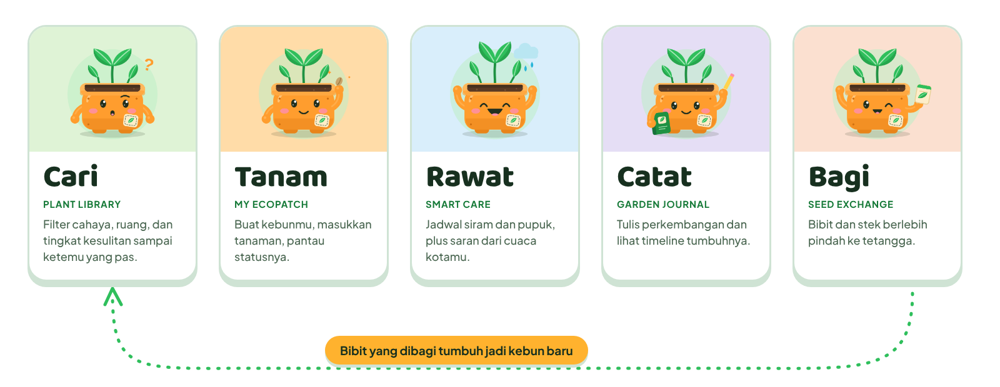
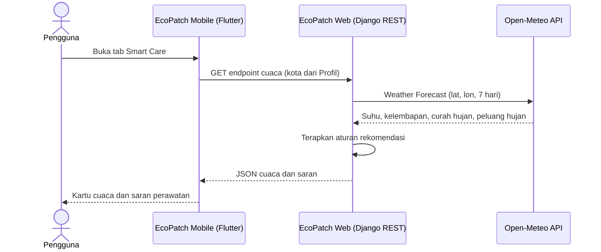
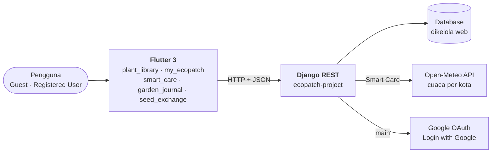
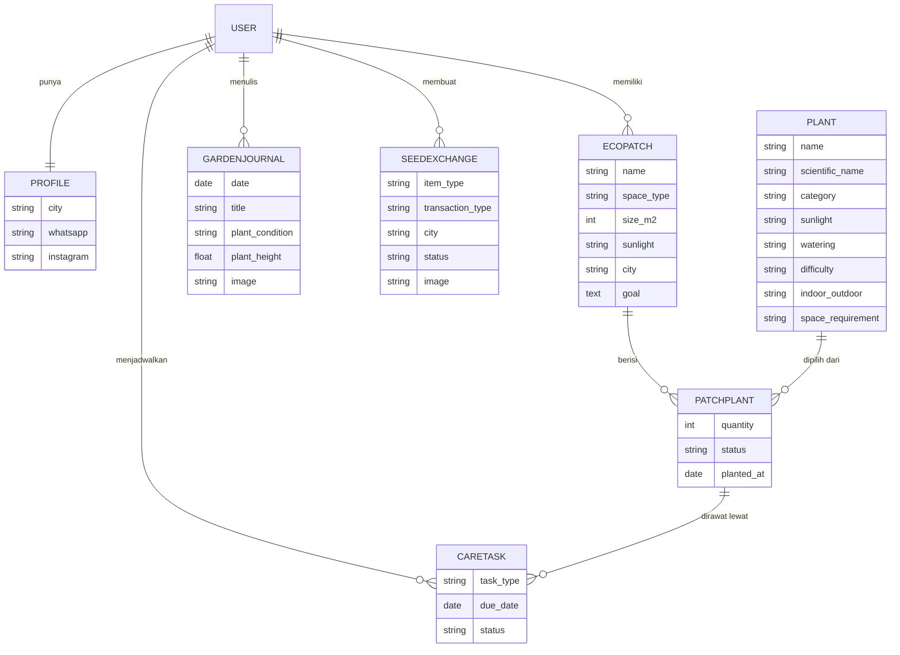

<div align="center">


<br>


**<a id="unduh-apk"></a>[Unduh APK](#tautan-desain--rilis)** &nbsp;·&nbsp; **[Desain di Figma](https://www.figma.com/design/oIDtpZy29QWfdudwhSFNb5/Untitled?node-id=0-1&t=LuUIQFP3lihxES26-1)** &nbsp;·&nbsp; **[Jalankan lokal](#jalankan-di-lokal)** &nbsp;·&nbsp; **[Tim](#tim)**

</div>

<br>

Balkon dua meter, kamar kos dengan satu jendela, atau rooftop yang kepanasan: semuanya bisa jadi kebun. **EcoPatch** membantu kamu tahu tanaman apa yang cocok, kapan harus menyiram, sudah sejauh apa tumbuhnya, dan ke mana bibit sisa bisa pergi. Semuanya ada di satu tempat, sekarang di ponsel.

Ini adalah aplikasi **mobile** EcoPatch yang dibangun dengan **Flutter** untuk Proyek Akhir Semester mata kuliah Pemrograman Berbasis Platform (PBP) Gasal 2026/2027. Subtema kami adalah **Sustainable Living › Urban Farming**: ruang sempit tetap bisa dihijaukan, dan bibit tidak terbuang karena bisa dipakai orang lain lewat Seed Exchange. Data dan aturannya sama dengan [EcoPatch web](https://salwa-alifia-eco-patch.pws.cs.ui.ac.id/), karena aplikasi ini memakai backend web tersebut lewat REST API.

---

## Status pengembangan

Repo ini masih di tahap awal. Kerangka aplikasi dan tema sudah berdiri, sedangkan isi tiap modul masih placeholder.

| Bagian | Status |
| --- | --- |
| Struktur modul, bottom navigation 5 tab, dan drawer | Selesai |
| Tema selaras web (warna, tipografi Baloo 2 + Plus Jakarta Sans, kartu dan pil) | Selesai |
| Ikon tiap modul dan logo | Disalin dari repo web, bukan ikon Material bawaan |
| Halaman tiap modul | Placeholder: judul, ringkasan modul, dan endpoint terkait |
| Endpoint Django REST Framework | Sudah berjalan di repo web (`/api/...`, token auth, 26 tes lulus), belum di-deploy ke PWS |
| Autentikasi, formulir, dan unggah foto di aplikasi | Belum. Halaman login/register dan pemanggilan API menyusul |
| Rilis APK | Belum, menunggu pipeline Bitrise |

Artinya, README ini menuliskan **modul dan perilaku yang dituju**, bukan fitur yang sudah jadi. Tiap bagian yang belum berjalan diberi keterangan.

---

## Alur integrasi: Flutter ↔ DRF ↔ PWS

Aplikasi mobile tidak punya database sendiri. Semua data dibaca dan ditulis lewat API Django REST Framework di situs PWS, dan aturan bisnisnya tetap di server.

| Langkah | Yang terjadi |
| --- | --- |
| 1. Login | `POST /api/auth/login/` mengirim username dan password, server membalas `token` |
| 2. Simpan token | Token disimpan di penyimpanan aman perangkat, bukan di kode |
| 3. Minta data | Setiap permintaan mengirim header `Authorization: Token <token>` |
| 4. Baca JSON | Respons `snake_case` diubah ke model Dart, lalu ditampilkan di layar modul |
| 5. Tulis data | Formulir mengirim `POST`/`PATCH`/`DELETE`, server memvalidasi, aplikasi memakai hasilnya |

Endpoint yang tersedia di bawah `/api/`:

| Grup | Endpoint | Akses |
| --- | --- | --- |
| Auth & profil | `auth/register/`, `auth/login/`, `auth/logout/`, `auth/me/` | publik untuk daftar dan login |
| Plant Library | `plants/`, `plants/<id>/`, `plants/recommendations/?patch=<id>` | baca publik, tulis admin |
| My EcoPatch | `ecopatches/`, `ecopatches/<id>/plants/`, `patch-plants/<id>/` | token |
| Smart Care | `smart-care/api/care-tasks/`, `care-tasks/<id>/complete/`, `weather/` | token / session |
| Garden Journal | `journal/api/`, `journal/api/books/`, `journal/api/<id>/` | token / session |
| Seed Exchange | `seeds/`, `seeds/<id>/book/`, `accept/`, `complete/`, `reopen/`, `cancel/` | baca publik, aksi token |

Respons galat mengikuti pola DRF: `400` untuk validasi, `401` tanpa token, `403` bukan admin, `404` untuk data milik orang lain. Halaman daftar memakai pagination (`count`, `next`, `previous`, `results`).

---

## Kenapa orang berhenti berkebun

Niat sudah ada, tapi lima hal ini sering menghentikan di tengah jalan. Tiap hal punya satu modul yang menjawabnya, dan di mobile semuanya dicapai tanpa membuka browser.

| Yang terpikir | Yang EcoPatch lakukan |
| --- | --- |
| "Tanaman apa yang cocok di balkonku?" | **Plant Library** menyaring tanaman berdasarkan cahaya, ruang, dan tingkat kesulitan, lalu merekomendasikan yang pas. |
| "Ruangku kecil dan teduh. Mulai dari mana?" | **My EcoPatch** menyimpan kebun virtualmu: jenis ruang, cahaya, kota, dan tanaman di dalamnya. |
| "Lupa menyiram. Atau menyiram padahal hujan." | **Smart Care** menjadwalkan perawatan dan memberi saran dari cuaca kotamu hari ini. |
| "Sudah sejauh mana tumbuhnya, ya?" | **Garden Journal** mencatat perkembangan tanaman dalam satu timeline. |
| "Bibit dan stekku berlebih." | **Seed Exchange** mempertemukanmu dengan orang yang mau menerima atau menukarnya. Tanpa pembayaran. |

**Untuk siapa:** mahasiswa kos, penghuni apartemen, warga kota dengan lahan terbatas, pemula yang baru mau mulai, dan siapa pun yang ingin hidup lebih berkelanjutan.

---

## Satu siklus, lima modul



| Modul | Fungsinya | Model | PIC |
| --- | --- | --- | --- |
| **Plant Library & Recommendation** | Katalog 60 tanaman dengan pencarian, filter, dan rekomendasi sesuai kondisi EcoPatch | `Plant` | Nurul Fikryati Bena |
| **My EcoPatch** | Kebun virtual: tipe ruang, cahaya, kota, tujuan, dan status tiap tanaman | `EcoPatch`, `PatchPlant` | Haikal Rafka A Rahman |
| **Smart Care** | Jadwal perawatan dengan saran dari cuaca kota (Open-Meteo) | `CareTask` | Salwa Alifia Putri |
| **Garden Journal** | Catatan bertimeline: kondisi, tinggi, foto, dan jumlah jurnal tiap tanaman | `GardenJournal` | Nur Azizah |
| **Seed Exchange** | Listing bibit, stek, dan tanaman untuk dibagi atau ditukar | `SeedExchange` | Rheina Uliana |

Kelima modul itu menjadi lima tab di bottom navigation. Di luar itu, aplikasi mobile memakai autentikasi dan profil yang sama dengan web, sehingga kota dan kontak tidak diisi dua kali.

> **Satu profil, satu kali isi.** Kota, nomor WhatsApp, dan Instagram diisi sekali di Profil web. Di mobile, data itu hanya dibaca dari API. My EcoPatch dan Smart Care memakai kotamu untuk cuaca, sedangkan Seed Exchange memakai kota dan kontakmu untuk listing.

<details>
<summary><b>Rincian fitur per modul</b></summary>

<br>

Rincian ini mengikuti modul web dan menjadi acuan implementasi di mobile. Selama status masih placeholder, isinya adalah target, bukan perilaku yang sudah berjalan.

### Plant Library & Recommendation

- Daftar tanaman dalam bentuk kartu, dan detail tanaman dibuka dari kartu tersebut
- Cari berdasarkan nama, lalu saring dengan kategori, kebutuhan sinar matahari, tingkat kesulitan, indoor/outdoor, dan kebutuhan ruang
- Rekomendasi sesuai kondisi EcoPatch pengguna. Rekomendasinya memakai **filtering data di Django**, tanpa Machine Learning atau AI, dan mobile hanya menampilkan hasilnya
- Tambah tanaman ke EcoPatch dari kartu atau halaman detail tanaman
- Atribut tanaman: nama, nama ilmiah, kategori, sinar matahari, frekuensi penyiraman, tingkat kesulitan, indoor/outdoor, kebutuhan ruang, deskripsi

### My EcoPatch

- Kebun virtual: nama, tipe ruang (`Balcony`, `Indoor`, `Terrace`, `Rooftop`, `Small Yard`), ukuran (m²), paparan matahari, kota (dari Profil), tujuan berkebun
- Tambah tanaman dari Plant Library, tentukan jumlah, catat tanggal mulai tanam, dan hapus tanaman dari EcoPatch
- Status tanaman: `Planned` → `Planted` → `Growing` → `Harvested` atau `Removed`

### Smart Care

- Daftar Care Task: `Watering`, `Fertilizing`, `Pruning`, `Repotting`, `Harvesting`, `Inspection`, bisa dikaitkan dengan tanaman di EcoPatch-mu
- Tandai tugas selesai langsung dari daftar, lalu lihat aktivitas berdasarkan tanggal
- Kartu cuaca kotamu (dari Profil) untuk 7 hari ke depan beserta saran sederhana (lihat [Public API Open-Meteo](#public-api-open-meteo))

### Garden Journal

- Tulis jurnal: EcoPatch, tanaman, tanggal, judul, catatan, tinggi tanaman (opsional), dan foto (opsional). Sampul buku tiap jurnal tetap ditampilkan seperti di web
- Kondisi tanaman: `Healthy`, `Needs Attention`, `Wilting`, `Flowering`, `Fruiting`, `Ready to Harvest`
- Timeline perkembangan, filter berdasarkan EcoPatch, tanaman, kondisi, dan tanggal, serta jumlah jurnal tiap tanaman

### Seed Exchange

- Listing dengan foto. Item: `Seed`, `Seedling`, `Cutting`, `Plant`. Transaksi: `Give Away`, `Swap`
- Alur status: `Available` → `Menunggu konfirmasi` → `Reserved` → `Completed`. Pengguna lain mem-booking listing, pemilik menerima booking lalu menandainya selesai
- Filter berdasarkan jenis item, tanaman, kota, jenis transaksi, dan status
- Tidak ada fitur pembayaran, karena fokusnya berbagi dan menukar

</details>

---

<a id="public-api-open-meteo"></a>

## Public API: Open-Meteo

EcoPatch memakai satu Public API eksternal, **Open-Meteo**, untuk menampilkan cuaca kota pengguna dan menyusun saran perawatan sederhana di Smart Care.

Aplikasi mobile **tidak memanggil Open-Meteo secara langsung**. Backend Django yang mengambil data, menerapkan aturan rekomendasi, lalu mengirim hasilnya sebagai JSON. Dengan begitu kunci, cache, dan aturan tetap satu tempat: di server, bukan di dua basis kode.



Contoh tampilan yang dituju di Smart Care:

```text
Today's Care · Depok
29°C · Kelembapan 78% · Peluang hujan 80% · Curah hujan 8 mm

Hujan cukup deras
Sekitar 8 mm hari ini. Tanaman outdoor mungkin tidak perlu disiram, cek tanah dulu.

[ ] Siram Cabai     [ ] Pupuk Tomat     [✓] Periksa Basil
```

Open-Meteo hanya penyedia data cuaca. **Aturan rekomendasinya dibuat dan dijalankan oleh EcoPatch.**

<details>
<summary><b>Data, kota, dan aturan rekomendasi</b></summary>

<br>

**Open-Meteo Weather Forecast API** dipanggil backend untuk modul Smart Care, dan aplikasi mobile menerima hasilnya.

**Data yang dipakai:** suhu, kelembapan relatif, curah hujan, peluang hujan, dan kode kondisi cuaca. Prakiraan 7 hari disimpan di cache backend selama 15 menit, dan bila Open-Meteo tidak menjawab dalam 5 detik, Smart Care tetap terbuka tanpa kartu cuaca.

**12 kota yang didukung:** Jakarta · Bogor · Depok · Tangerang · Bekasi · Bandung · Semarang · Yogyakarta · Surabaya · Malang · Medan · Makassar

Pengguna tidak perlu mengetik koordinat. Kota diambil dari Profil (bila kosong, dari kota EcoPatch, lalu Depok), dan koordinatnya disimpan sebagai data internal di backend:

```python
CITIES = {
    "Jakarta": (-6.20, 106.81),
    "Bogor": (-6.59, 106.79),
    "Depok": (-6.40, 106.82),
    # ...
}
```

**Aturan rekomendasi.** Dari atas ke bawah, aturan pertama yang cocok menjadi headline kartu cuaca:

| Kondisi | Saran yang tampil |
| --- | --- |
| Peluang hujan ≥ 70% **dan** curah ≥ 5 mm | **Hujan cukup deras.** Tanaman outdoor mungkin tidak perlu disiram, cek tanah dulu. |
| Peluang hujan ≥ 70% tapi curah < 5 mm | **Hujan ringan.** Kemungkinan hanya gerimis, siram sesuai jadwal. |
| Suhu maksimum ≥ 32°C | **Cuaca panas.** Cek kelembapan media tanam. |
| Kelembapan ≥ 85% | **Udara lembap.** Periksa daun dari tanda jamur. |
| Selain itu | **Cuaca aman.** Waktu yang pas untuk merawat tanaman. |

Peluang hujan saja belum cukup untuk menyebut hari itu hujan, karena di musim hujan angkanya hampir selalu tinggi di sore hari walau hanya turun beberapa tetes. Karena itu aturan pertama juga menunggu curah hujan minimal 5 mm.

</details>

---

## 60 tanaman siap pakai

Katalognya sama dengan web dan dimuat dari backend, jadi tidak ada katalog kosong di hari pertama.

| Kategori | Jumlah |
| --- | -: |
| Vegetables | 15 |
| Flowers | 12 |
| Herbs | 10 |
| Indoor / Low-Light Plants | 10 |
| Fruit / Container Plants | 8 |
| Aromatic / Useful Plants | 5 |
| **Total** | **60** |

---

<a id="siapa-boleh-melakukan-apa"></a>

## Siapa boleh melakukan apa

Aplikasi mobile punya dua jenis pengguna. Guest boleh melihat-lihat, Registered User mengelola data miliknya sendiri. Peran Admin dan pengelolaan data master tetap di web, karena tugasnya menyangkut seluruh aplikasi, bukan satu perangkat.

| | Guest | Registered User |
| --- | :-: | :-: |
| Lihat Plant Library dan jelajahi Seed Exchange | ✓ | ✓ |
| Cari dan filter tanaman | ✓ | ✓ |
| Buat dan kelola EcoPatch | – | ✓ |
| Tambah tanaman ke EcoPatch | – | ✓ |
| Buat Care Task dan lihat cuaca | – | ✓ |
| Buat Garden Journal | – | ✓ |
| Buat listing dan booking Seed Exchange | – | ✓ |
| Atur profil (kota dan kontak) | – | ✓ |
| Ubah atau hapus data **milik sendiri** | – | ✓ |

Guest tidak bisa mengubah atau menghapus data milik pengguna lain, dan tombol yang tidak berhak dipakai tidak ditampilkan.

---

## Di ponsel, semuanya satu tarikan jempol

| Bagian | Perilaku |
| --- | --- |
| Bottom navigation | Lima modul dalam lima tab: Library, My EcoPatch, Smart Care, Journal, Exchange. Perpindahan tab memakai `IndexedStack`, jadi posisi daftar tidak hilang saat berpindah |
| Drawer | Menu yang sama bisa dibuka dari kiri atas, berguna saat layar lebar atau saat tab bawah sedang disembunyikan |
| Tampilan | Design system web dipakai ulang: token warna `:root` di CSS, judul Baloo 2, teks Plus Jakarta Sans, kartu putih bergaris earthy, dan ikon modul dari repo web |
| Kartu tanaman | Dibuka jadi halaman detail, dan tombol tambah ada di kartu maupun di detail |
| Konfirmasi hapus | Selalu lewat dialog konfirmasi, bukan langsung menghapus |
| Data dari server | Setelah integrasi API: tarik untuk menyegarkan, indikator memuat, dan pesan galat yang bisa dicoba ulang |

---

## Di balik layar



Aplikasi mobile tidak punya database sendiri. Semua data tinggal di backend, dan model yang dipakai adalah model web:



| Lapisan | Pilihan |
| --- | --- |
| Framework | Flutter 3.47 (Dart 3) |
| UI | Material 3 dengan design system web: token warna dan tipografi di `lib/theme/`, ikon SVG di `assets/icons/` |
| Navigasi | Bottom navigation 5 tab, drawer, dan `IndexedStack` |
| Backend | Django REST Framework dari EcoPatch web. Aplikasi hanya membaca dan mengirim JSON, aturan bisnis tetap di server |
| Autentikasi | Sesi dan token dari backend, termasuk Login with Google yang sudah ada di web |
| Public API | Open-Meteo, dipanggil backend dan bukan langsung dari ponsel |
| Pengujian | `flutter test` dan `flutter analyze` |
| Distribusi | Bitrise menghasilkan APK release |
| Deployment web | PWS (Fasilkom UI) |

---

<a id="jalankan-di-lokal"></a>

## Jalankan di lokal

```bash
git clone <url-repository> ecopatch-mobile
cd ecopatch-mobile

flutter pub get
flutter run                # perangkat atau emulator yang sedang aktif
flutter run -d chrome      # cara cepat untuk melihat tampilan
```

- **Butuh backend yang hidup.** Setelah integrasi API masuk, aplikasi membaca alamat backend dari satu konfigurasi. Untuk development, arahkan ke `http://127.0.0.1:8000`; untuk demo di perangkat fisik, pakai alamat PWS.
- **Versi Flutter.** Repo ini diuji dengan Flutter 3.47. Menjalankan `flutter pub get` dengan versi Flutter lain bisa mengubah `pubspec.lock` dan file `generated_plugin_registrant` di `android/`, `ios/`, `linux/`, `macos/`, dan `windows/`. Perubahan itu normal, tetapi jangan di-commit kalau bukan bagian dari pekerjaanmu.
- **Membangun APK:** `flutter build apk --release`. Bitrise menjalankan langkah yang sama untuk rilis.
- **Memeriksa kode:** `flutter analyze` untuk lint, dan `flutter test` untuk widget test.

---

## Struktur repository

```text
ecopatch-mobile/
├── lib/
│   ├── main.dart                 # entry point dan tema aplikasi
│   ├── screens/                  # shell navigasi: bottom navigation 5 tab
│   ├── widgets/                  # komponen bersama: drawer, ikon modul, halaman modul
│   ├── theme/                    # token warna, tipografi, dan daftar modul dari CSS web
│   ├── plant_library/screens/    # Plant Library & Recommendation
│   ├── my_ecopatch/screens/      # My EcoPatch
│   ├── smart_care/screens/       # Smart Care
│   ├── garden_journal/screens/   # Garden Journal
│   └── seed_exchange/screens/    # Seed Exchange
├── assets/
│   ├── icons/                    # ikon modul dari templates/header.html repo web
│   └── images/                   # logo EcoPatch dari static/img/logo.svg
├── test/                         # widget test
├── android/ ios/ web/ windows/ linux/ macos/   # target platform Flutter
└── docs/readme/                  # gambar untuk README ini
```

Setiap modul punya folder sendiri di bawah `lib/`, mengikuti nama modul di web. Jadi satu modul bisa dikerjakan satu orang tanpa menyentuh folder modul lain.

---

<a id="tautan-desain--rilis"></a>

## Tautan desain & rilis

- **Desain UI/UX (Figma):** [Desain Figma EcoPatch](https://www.figma.com/design/oIDtpZy29QWfdudwhSFNb5/Untitled?node-id=0-1&t=LuUIQFP3lihxES26-1)
- **APK release (Bitrise):** belum tersedia. Tautan akan ditambahkan menjelang pengumpulan akhir.
- **Website & sumber data:** <https://salwa-alifia-eco-patch.pws.cs.ui.ac.id/>

---

<a id="tim"></a>

## Tim

Setiap anggota memegang satu modul (PIC) beserta model utamanya, dan modul itu muncul sebagai satu tab di aplikasi.

<table>
  <tr>
    <td align="center" width="20%"><br><b>Nurul Fikryati Bena</b><br><code>2506534825</code><br><b>PIC Plant Library</b><br><code>Plant</code></td>
    <td align="center" width="20%"><br><b>Haikal Rafka A Rahman</b><br><code>2506553383</code><br><b>PIC My EcoPatch</b><br><code>EcoPatch</code>, <code>PatchPlant</code></td>
    <td align="center" width="20%"><br><b>Salwa Alifia Putri</b><br><code>2506620280</code><br><b>PIC Smart Care</b><br><code>CareTask</code></td>
    <td align="center" width="20%"><br><b>Nur Azizah</b><br><code>2506547935</code><br><b>PIC Garden Journal</b><br><code>GardenJournal</code></td>
    <td align="center" width="20%"><br><b>Rheina Uliana</b><br><code>2506600801</code><br><b>PIC Seed Exchange</b><br><code>SeedExchange</code></td>
  </tr>
</table>

---

## Pengungkapan Penggunaan AI

_Placeholder._

<details>
<summary><b>1. Tools AI dan perannya</b></summary>

<br>

| Tool | Digunakan oleh | Peran umum |
| --- | --- | --- |
|  |  |  |

</details>

<details>
<summary><b>2. Area yang dibantu AI</b></summary>

<br>

| Area | Contoh aktivitas |
| --- | --- |
|  |  |

</details>

<details>
<summary><b>3. Strategi prompt dan alur kerja</b></summary>

<br>

| Strategi | Contoh |
| --- | --- |
|  |  |

</details>

<details>
<summary><b>4. Review manusia, implementasi, dan verifikasi</b></summary>

<br>

_Placeholder._

</details>

<details>
<summary><b>5. Keterbatasan AI dan perbaikan manual</b></summary>

<br>

| Temuan | Cara diketahui dan tindakan korektif |
| --- | --- |
|  |  |

</details>

<details>
<summary><b>6. Dokumentasi prompt</b></summary>

<br>

_Placeholder._

</details>

---

<br>

<div align="center">

**Small Spaces, Greener Living**

Dibuat dengan Flutter · Proyek Akhir Semester PBP Gasal 2026/2027

</div>
